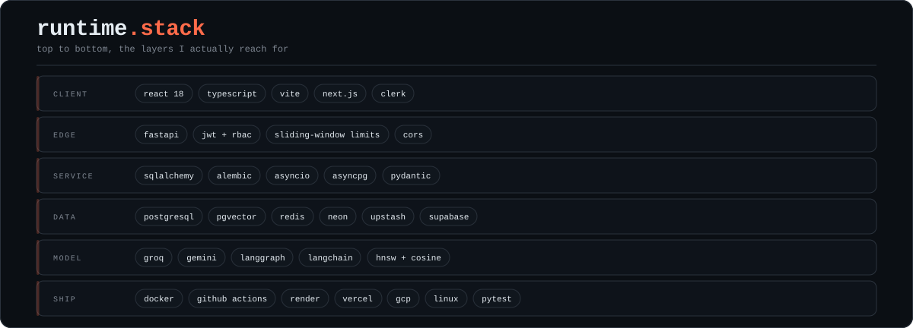

<!-- Topology + trace are generated: `python assets/build_svgs.py` -->

<picture>
  <source media="(prefers-color-scheme: dark)" srcset="assets/system-dark.svg">
  <source media="(prefers-color-scheme: light)" srcset="assets/system-light.svg">
  
</picture>

## `GET /whoami` &nbsp;`200 OK`

# Shardul Shripad Hingane

### Backend & AI systems engineer

Building reliable APIs and grounded AI.

**Open to backend / AI-infra work.**

---

## `GET /live` &nbsp;`200 OK`

| Project | Overview | Benchmark | Links |
|---|---|---|---|
| **health-assistant** · `live` | Grounded health Q&A with source citations, red-flag checks, and refusal when sources fall short. | **90% retrieval hit rate** in a 30-question in-corpus benchmark. | [Demo](https://health-assistant-lake.vercel.app) · [Code](https://github.com/Shardul9999/Health_Assistant) · [API health](https://health-assistant-api-3aoy.onrender.com/health) |
| **url-shortener** · `live` | SSRF-hardened redirects with Redis caching, rate limits, and click analytics. | **~6× faster cached lookups** — 39.96ms → 6.68ms. | [Demo](https://url-shortener-eight-murex.vercel.app/) · [Code](https://github.com/Shardul9999/url-shortener) · [API docs](https://url-shortener-672q.onrender.com/docs) · [API health](https://url-shortener-672q.onrender.com/health) |

Health-assistant may take 30–60s to wake up. Open API health first if the demo is waiting.

health-assistant — benchmarks & deployment

React · FastAPI · Postgres + pgvector · Redis · Groq / Gemini fallback.

Measured across 50 documents / 168 chunks. [Full benchmark report](https://github.com/Shardul9999/Health_Assistant/blob/main/docs/BENCHMARKS.md).

| Metric | Result |
|---|---|
| Retrieval hit rate, in-corpus | 90% — 27/30 |
| False hits, out-of-corpus | 0/8 — similarity margin 0.172 |
| Answers carrying citations | 27/27 — all 129 citations valid |
| Red-flag detection | 12/12 — none reached the model |
| End-to-end p50 / p95 | 2512ms / 3981ms |

url-shortener — benchmarks & deployment

React · FastAPI · Postgres · Redis. Frontend on Vercel, API on Render.

| Metric | Result |
|---|---|
| Cache miss — Postgres round-trip | ~39.96ms |
| Cache hit — Redis | ~6.68ms |
| Test suite & coverage | 22 tests — 94% coverage |
| Sliding-window limits | 100 req/min shorten · 1,000 req/min redirect |

---

## `GET /runtime`

<picture>
  <source media="(prefers-color-scheme: dark)" srcset="assets/stack-dark.svg">
  <source media="(prefers-color-scheme: light)" srcset="assets/stack-light.svg">
  
</picture>

---

## `GET /health`

<picture>
  <source media="(prefers-color-scheme: dark)" srcset="assets/health-dark.svg">
  <source media="(prefers-color-scheme: light)" srcset="assets/health-light.svg">
  
</picture>

**[portfolio](https://shardulportfolio-rose.vercel.app/)** · **[linkedin](https://linkedin.com/in/ShardulHingane)** · **[leetcode](https://leetcode.com/u/shardul_16/)** · **[email](mailto:shardulhingane16@gmail.com)**
